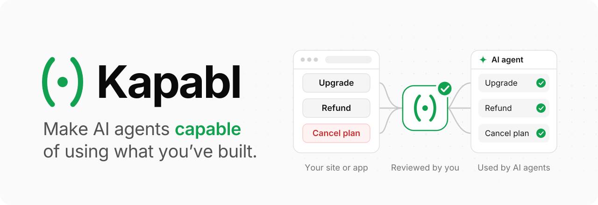
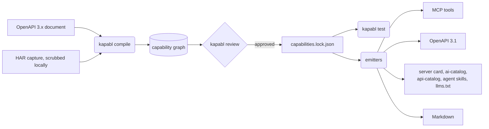

<a name="top"></a>
<a href="#-about">
  <picture>
    <source media="(prefers-color-scheme: dark)" srcset=".github/assets/banner-dark.svg">
    
  </picture>
</a>

[](https://github.com/kapablhq/kapabl/actions/workflows/ci.yml)
[](LICENSE)
[](#%EF%B8%8F-roadmap)
[](https://modelcontextprotocol.io/specification/2026-07-28/changelog)
[](https://spec.openapis.org/oas/v3.1.0)
[](https://nodejs.org/)
[](tsconfig.base.json)
[](https://github.com/kapablhq/kapabl/actions/workflows/ci.yml)
[](https://kapabl.dev/docs)

⭐ If Kapabl is useful to you, star the repository: it helps other people find it.

[](https://x.com/intent/post?text=Kapabl%3A%20make%20AI%20agents%20capable%20of%20using%20what%20you%27ve%20built&url=https%3A%2F%2Fgithub.com%2Fkapablhq%2Fkapabl)
[](https://www.linkedin.com/sharing/share-offsite/?url=https%3A%2F%2Fgithub.com%2Fkapablhq%2Fkapabl)
[](https://www.reddit.com/submit?url=https%3A%2F%2Fgithub.com%2Fkapablhq%2Fkapabl&title=Kapabl%3A%20make%20AI%20agents%20capable%20of%20using%20what%20you%27ve%20built)
[](https://news.ycombinator.com/submitlink?u=https%3A%2F%2Fgithub.com%2Fkapablhq%2Fkapabl&t=Kapabl%3A%20make%20AI%20agents%20capable%20of%20using%20what%20you%27ve%20built)
[](https://t.me/share/url?url=https%3A%2F%2Fgithub.com%2Fkapablhq%2Fkapabl&text=Kapabl%3A%20make%20AI%20agents%20capable%20of%20using%20what%20you%27ve%20built)

**Make AI agents capable of using what you've built. These packages turn the actions in your site or app into reviewed, typed tools for AI agents, including the logged-in and destructive actions a public API doesn't cover. Everything here runs on your machine and uploads nothing.**

## Table of Contents
- [About](#-about)
- [Quickstart](#-quickstart)
- [How It Works](#%EF%B8%8F-how-it-works)
- [Packages](#-packages)
- [Roadmap](#%EF%B8%8F-roadmap)
- [Documentation](#-documentation)
- [Hosted Kapabl](#-hosted-kapabl)
- [Feedback and Contributions](#-feedback-and-contributions)
- [License](#-license)
- [Contacts](#%EF%B8%8F-contacts)

## 🚀 About

These packages compile an OpenAPI document or a browser capture (HAR) into a **capability graph**: one reviewed, typed description of what an agent may do in your site or app. Every agent-facing file is then generated from that one graph, so nothing drifts: MCP tool definitions, discovery files, `llms.txt`, Markdown and OpenAPI 3.1.

- **Scrubbed before it is read.** A HAR capture loses its cookies, tokens, API keys and personal data on your machine, before anything stores it or a model sees it.
- **Careful by default.** GET is assumed to read. Anything else is assumed to write, and anything that deletes, cancels, refunds, pays or transfers is assumed destructive, until you say otherwise.
- **Nothing goes live unreviewed.** `kapabl review` writes your decisions to `capabilities.lock.json`, a file you commit. A change to an approved action needs approving again.
- **Tested against your API.** Each approved action gets a contract test. Reads run by default, writes only when you ask, and destructive actions never.
- **Data, not instructions.** Generated text that agents read holds facts and structure only, never prompts telling an agent what to do or recommend.

## ⚡ Quickstart

The packages are not on npm yet, so run the CLI from a clone. You need **Node 24 LTS** and Corepack; there is no build step.

```shell
git clone https://github.com/kapablhq/kapabl.git
cd kapabl
corepack enable
pnpm install
alias kapabl="node $PWD/packages/cli/bin/kapabl.ts"
```

Start with the **action audit**: one HTML page listing every action found, grouped into reads, writes and destructive actions, who can call each one, which credential reaches your API, and what was left out and why.

```shell
kapabl audit --openapi openapi.yaml    # or --har capture.har; writes audit.html
```

Then the full workflow, in your own project:

```shell
kapabl compile --openapi openapi.yaml --tenant acme   # or --har capture.har
kapabl review                         # approve each action; writes kapabl/capabilities.lock.json
kapabl test                           # contract tests against your API (reads by default)
kapabl emit --openapi out.json        # an OpenAPI 3.1 document of the approved actions
```

Run `kapabl --help` for every command and option.

## ⚙️ How It Works



1. **Compile.** The compiler imports OpenAPI 3.0 or 3.1, or infers actions from a scrubbed HAR (path templates and JSON Schemas merged from the samples). Each action carries where it came from, a confidence score and its side-effect class.
2. **Review.** You approve, reject or correct each action. Only approved actions reach the lockfile, and only the lockfile reaches the emitters.
3. **Emit.** `@kapabl/emitters` generates each agent-facing file from the approved graph. The CLI writes OpenAPI 3.1 today; the other files come from the library, which a runtime (yours or [Kapabl's](#-hosted-kapabl)) serves.

## 📦 Packages

| Package | What it does |
|:-|:-|
| [`@kapabl/graph`](packages/graph) | Capability graph schema (Zod 4, exported as JSON Schema 2020-12) and the lockfile format |
| [`@kapabl/compiler`](packages/compiler) | OpenAPI 3.0/3.1 import, HAR scrubbing and inference, contract tests |
| [`@kapabl/emitters`](packages/emitters) | Graph to MCP tools, server card, `ai-catalog.json`, `api-catalog` (RFC 9727), Agent Skills index, `llms.txt`, Markdown and OpenAPI 3.1 |
| [`@kapabl/cli`](packages/cli) | The `kapabl` command: `audit`, `compile`, `review`, `example`, `test`, `emit` |
| [`@kapabl/sdk-hono`](packages/sdk-hono) | Middleware for Hono apps (in progress) |

## 🗺️ Roadmap

- [x] Capability graph and lockfile
- [x] OpenAPI import, HAR scrubbing and inference
- [x] Owner review, contract tests and the action audit
- [x] Emitters for MCP tools, discovery files, Markdown and OpenAPI 3.1
- [ ] Publish the packages to npm, so `npx @kapabl/cli` works
- [ ] Middleware for Hono, then Next.js and Express

## 📚 Documentation

- [kapabl.dev/docs](https://kapabl.dev/docs): the workflow, every command and how actions are labeled.
- [AGENTS.md](AGENTS.md): the rules every change follows, for people and coding agents.
- [`packages/graph/schema/`](packages/graph/schema): the capability graph and lockfile as JSON Schema, for editors and other tools.

## 💎 Hosted Kapabl

Prefer not to run the agent-facing side yourself? [Kapabl](https://kapabl.dev) serves your approved actions at `agents.yourdomain.com`, with sign-in through your existing login so assistants act as the signed-in user, confirmation for destructive actions such as refunds, cancellations and deletes, and an audit log of every call. One plan: $19 a month (₹999 in India). See [pricing](https://kapabl.dev/pricing).

The action audit and everything in this repository stay free.

## 🤝 Feedback and Contributions

Kapabl is pre-alpha: what breaks on your API is what we can't see from here. A report that names the input (an OpenAPI document or a scrubbed HAR, trimmed to the part that fails) and the command you ran turns a guess into a fix.

- [Open an issue](https://github.com/kapablhq/kapabl/issues) for bugs, wrong inferences and ideas.
- Read [CONTRIBUTING.md](CONTRIBUTING.md) before a pull request: contributions come in under Apache-2.0 with a DCO sign-off (`git commit -s`).

Development checks:

```shell
pnpm lint && pnpm check:spdx && pnpm typecheck && pnpm build && pnpm test
```

## 📄 License

[Apache-2.0](LICENSE). Use it, change it and ship it, commercially or not.

## 🗨️ Contacts

- General questions: [hello@kapabl.dev](mailto:hello@kapabl.dev)
- Security reports: [security@kapabl.dev](mailto:security@kapabl.dev), privately, never in an issue
- Website: [kapabl.dev](https://kapabl.dev)

[Back to top ↑](#top)
